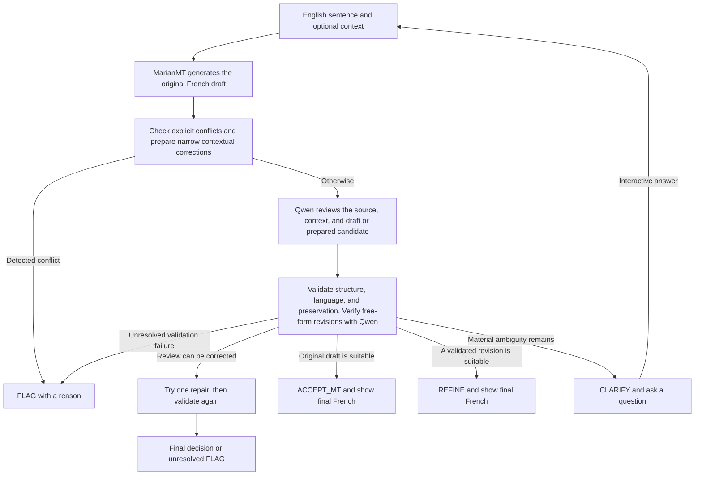

# LinguaBridge AI

LinguaBridge AI is a **single-agent, context-aware English-to-French translation
project**. A translation can be fluent and still miss the intended sense of a
word, use the wrong form of address, or disagree with the speaker's gender.
LinguaBridge starts with a MarianMT draft, checks it against the English and
optional context, and can ask for clarification or withhold a questionable result.

The project aims to translate ordinary sentences on CPU, make contextual
decisions visible, and measure when review helps or hurts. Use MarianMT alone
for a direct baseline, or use the agent with formality, speaker or listener
gender, and intended meaning. A multi-sentence CLI loads the models once. The local **Translation Studio**
adds a split-panel web interface with context controls, clarification, and
a draft-to-final comparison. [Open the Studio setup guide](STUDIO_SETUP.md)

## Architecture



| Model | Role |
|---|---|
| [MarianMT](https://huggingface.co/Helsinki-NLP/opus-mt-en-fr) | Generates the initial draft and translates supported English paraphrases. |
| [Qwen2.5-0.5B-Instruct](https://huggingface.co/Qwen/Qwen2.5-0.5B-Instruct) | Reviews the English, context, and French, and verifies free-form revisions using the same loaded model. |

Narrow rules can prepare corrections for supported verb forms, agreement,
ambiguous senses, and idioms. A validated rule-based correction can take
precedence over Qwen's response. An explicit contradiction may be flagged
before Qwen is needed. Validation checks output language, common negation
markers, likely names, digit sequences, and supported context constraints.
A failed review gets at most one repair when a validated correction is
unavailable. `CLARIFY` and `FLAG` show the original draft but leave the final
translation unset.

## CPU installation

Use Python 3.12 on Linux. Allow a few GB of free disk for the Python environment
and model weights. The first translation downloads the weights from Hugging
Face. Subsequent runs reuse the local cache. GPU and API credentials are
unnecessary for the tested CPU path.

```bash
git clone https://github.com/S-Sanjitha/LinguaBridge-AI.git
cd LinguaBridge-AI
python -m venv .venv
source .venv/bin/activate
python -m pip install --index-url https://download.pytorch.org/whl/cpu 'torch>=2.6,<3'
python -m pip install -r requirements.txt
```

Set `HF_HOME` to a writable cache directory if needed, for example
`export HF_HOME="$PWD/hf-cache"`. Once the needed weights are cached, set
`HF_HUB_OFFLINE=1` for an offline run.

## CLI

```bash
python -m linguabridge --mt-only "Hello, how are you?"
python -m linguabridge "Can you open the window?" --formality formal
python -m linguabridge "I am proud of my work." --speaker-gender feminine
python -m linguabridge "I went to the bank." --meaning "The bank of a river"
python -m linguabridge --interactive
```

The one-shot command also accepts input at a prompt when the sentence is omitted.
Use `--formality formal|informal`, `--speaker-gender feminine|masculine`,
`--listener-gender feminine|masculine`, and `--meaning "…"` in agent mode.
In interactive mode, the options act as defaults for the session. The context
prompt accepts per-sentence meaning, and a clarification answer retries that
sentence once using the loaded models. Enter `:quit`, `:q`, or `:exit` to leave.
Use `--interactive --mt-only` to translate multiple sentences with MarianMT alone.

| Input | Context | Observed result |
|---|---|---|
| Hello, how are you? | MarianMT only | Bonjour, comment allez-vous ? |
| Can you open the window? | Formal | `REFINE` · Vous pouvez ouvrir la fenêtre ? |
| I am proud of my work. | Feminine speaker | `REFINE` · Je suis fière de mon travail. |
| I saw a bat. | None | `CLARIFY` · asks which meaning of “bat” applies. |

[5–7 minute demo guide](DEMO_GUIDE.md) · [Project overview](PROJECT_OVERVIEW.md)

## Evaluation

The benchmark uses **25 aligned English–French FLORES-200 `devtest` pairs**.
The constructed contextual sets contain 20 development cases and 20 separate
holdout cases. Contextual correctness is a manual judgment of meaning, context,
and appropriate abstention. Decision matches compare exact labels. Output
coverage counts nonempty outputs, while valid-French coverage requires the
language check to pass. BLEU and chrF are corpus-level reference-overlap scores.
For the all-input benchmark scores, invalid or unresolved translations are
scored as empty hypotheses.

| Phase 4.1 result | Contextually correct | Exact decision matches | Valid French |
|---|---:|---:|---:|
| Development · LinguaBridge | 19/20 | 18/20 | 15/20 |
| Holdout · LinguaBridge | 17/20 | 15/20 | 16/20 |
| Holdout · MarianMT | 12/20 | — | 20/20 |
| Holdout · direct Qwen | 4/20 | — | 18/20 |

On FLORES-200, MarianMT scored **51.60 BLEU / 69.69 chrF**. The Phase 4.1 agent
scored **51.05 BLEU / 69.42 chrF**. Both covered all 25 pairs, so resolved and
all-input scores coincide. The small contextual sets show gains on the
reviewed cases and do not establish broad generalization.

[Phase 4 baseline](evaluation/REPORT.md) · [Phase 4.1 comparison and raw results](evaluation/PHASE_4_1.md)

## Limitations

Language identification and meaning checks are imperfect. The holdout includes
missed compound-verb agreement, an unnecessary clarification, and a literal
idiom. Qwen can make a correct draft unresolved if its review and repair fail.
The extra model and validation steps also add CPU latency.

## Repository structure

| Path | Contents |
|---|---|
| `linguabridge/` | CLI, model adapters, agent routing, contextual rules, and validation |
| `studio/` | React, TypeScript, Tailwind, and Vite frontend |
| `linguabridge/api.py` | Loopback FastAPI interface and shared CPU model runtime |
| `tests/` | Unit tests, API tests, and MarianMT integration tests |
| `evaluation/` | Dataset definitions, runners, reports, and preserved CPU results |
| `PROJECT_OVERVIEW.md`, `DEMO_GUIDE.md` | Project summary and presentation walkthrough |

## Test and reproduce

```bash
python -m pip install -r requirements-api.txt
python -m pytest -q
curl -fL https://dl.fbaipublicfiles.com/nllb/flores200_dataset.tar.gz -o /tmp/flores200_dataset.tar.gz
python -m evaluation.run benchmark --archive /tmp/flores200_dataset.tar.gz --limit 25 --threads 1
python -m evaluation.run challenge --threads 1
python -m evaluation.run holdout --threads 1
python -m evaluation.compare
```

Run `npm ci && npm test && npm run build` from `studio/` for the frontend checks.

The Python tests include real MarianMT inference. Agent and CLI unit tests use mocks.
The evaluation commands run both pretrained models and write updated CSV/JSON
into `evaluation/results/phase4_1/`; use `--output` and `--current` to keep a
fresh run elsewhere. The runner verifies the original archive digest. The
[Phase 4.1 report](evaluation/PHASE_4_1.md) records model revisions, data provenance,
metric definitions, CPU settings, and failure examples.
