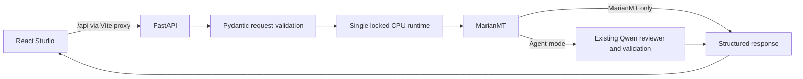

# LinguaBridge Translation Studio

The studio runs locally. React sends JSON to FastAPI through Vite's
same-origin proxy. FastAPI translates with the existing Python pipeline on
CPU. The CLI, evaluation scripts, and published evaluation data remain
available. Studio integration adds a way to use the models and does not change
the evaluation results.



MarianMT loads on the first valid translation request. Qwen loads on the
first agent request. The process reuses both across subsequent requests.
One lock covers initialization and inference, so concurrent translation
requests queue. Health checks can still report loading state. In
MarianMT-only mode, Qwen stays unloaded if no agent request has run.

## Windows setup · HP Spectre x360

Open PowerShell in your existing `LinguaBridge-AI` folder. These commands
assume your Python 3.11 environment is named `.venv`. Substitute its folder
name if yours differs.

### Install dependencies

```powershell
.\.venv\Scripts\python.exe --version
.\.venv\Scripts\python.exe -m pip install -r requirements.txt -r requirements-api.txt
node --version
```

If Node is missing or is below the supported version, install the LTS release
and open a new PowerShell terminal. Vite supports Node 20.19+ in the 20.x line
or 22.12+.

```powershell
winget install --id OpenJS.NodeJS.LTS --exact
```

The existing virtual environment should already have PyTorch. For a fresh
Windows venv, install CPU PyTorch before the requirements command above.

```powershell
.\.venv\Scripts\python.exe -m pip install --index-url https://download.pytorch.org/whl/cpu "torch>=2.6,<3"
```

### Start FastAPI in terminal 1

From the repository root:

```powershell
$env:OMP_NUM_THREADS = "2"
$env:MKL_NUM_THREADS = "2"
.\.venv\Scripts\python.exe -m uvicorn linguabridge.api:app --host 127.0.0.1 --port 8000 --workers 1
```

### Start React in terminal 2

From the repository root:

```powershell
Set-Location studio
npm.cmd ci
npm.cmd run dev
```

### Open Microsoft Edge

In another PowerShell terminal, run:

```powershell
Start-Process "microsoft-edge:http://127.0.0.1:5173"
```

Try “Can you open the window?” with Formal selected. In the verified CPU run
the agent displayed the draft “Tu peux ouvrir la fenêtre ?” and refined it to
“Vous pouvez ouvrir la fenêtre ?”. Try “I went to the bank.” with context
blank to exercise clarification.

## API

| Method | Path | Purpose |
|---|---|---|
| GET | `/api/health` | Service and device status, plus `idle`, `loading`, `ready`, or `error` for each model. |
| POST | `/api/translate` | Submit source text, mode, optional agent context, and optional clarification. |
| GET | `/docs` | Interactive OpenAPI documentation at the backend origin. |

```json
{
  "text": "I went to the bank.",
  "mode": "agent",
  "context": {"speaker_gender": "masculine"},
  "clarification": "The bank of a river"
}
```

Context accepts `formality` (formal or informal), `speaker_gender` and
`listener_gender` (feminine or masculine), and free-text `meaning`. An optional
`clarification` is appended to meaning, preserving the original text and
other choices. Follow-ups are stateless. The browser resends the submitted
source and context. Use `mode: "mt_only"` without context for the baseline.

Responses return the original draft, decision, outcome, validation status,
explanation, and applicable final text, question, or reason. The outcomes
are `resolved`, `clarification`, and `flagged`. Unresolved results have no final
French. An agent result marked `passed` passed the existing heuristics.
MarianMT-only returns `not_run` for agent validation. Invalid requests get a
422, initialization failures get a 503, and unexpected inference failures get
a generic 500.

## Development

- `studio/src/App.tsx` contains the translation panels, context inputs,
  clarification form, and Agent Insights.
- `studio/src/api.ts` handles the HTTP requests and typed responses.
- `studio/src/styles.css` combines Tailwind utilities with the studio styles.
- `linguabridge/api.py` contains the API schemas and shared model runtime.

From the repository root, after installing both requirement files, run
`python -m pytest -q`. From `studio/`, use `npm.cmd test` and
`npm.cmd run build`. On Linux or macOS use `npm` instead of `npm.cmd`.
Vite's production build writes `studio/dist/`. While FastAPI is running,
`npm.cmd exec vite preview` serves the built app on `127.0.0.1:4173` with the
same API proxy.

## Troubleshooting and limits

- **Backend offline** · Keep terminal 1 open. Run
  `Invoke-RestMethod http://127.0.0.1:8000/api/health` to check the service.
  The frontend and backend commands assume ports 5173 and 8000.
- **First translation is slow** · The first request downloads the required
  weights and loads the models. Allow several GB for the venv and cache. Set
  `$env:HF_HOME = "$PWD\hf-cache"` before starting the backend to pick a
  writable cache. Use `HF_HUB_OFFLINE=1` only after the weights are cached.
- **Model load failed** · Check the backend terminal and Hugging Face access.
  A subsequent request will retry initialization. Try MarianMT-only to
  isolate a Qwen failure.
- **Long input or unresolved response** · The API accepts 3,000 source
  characters and up to 1,000 characters each for context and clarification;
  model token limits can require shorter input. A clarification or flag can
  withhold a correct draft. Some ambiguity, idiom, and agreement errors
  remain documented in the [evaluation report](evaluation/PHASE_4_1.md).
- **Local use** · Both launch commands bind to loopback. CORS allows the
  configured local Vite origins, and foreign browser origins and hostnames
  are rejected. The service has no public authentication
  or rate limiting. Windows instructions target Python 3.11 with CPU wheels;
  the integration was verified on Linux with Chromium.
